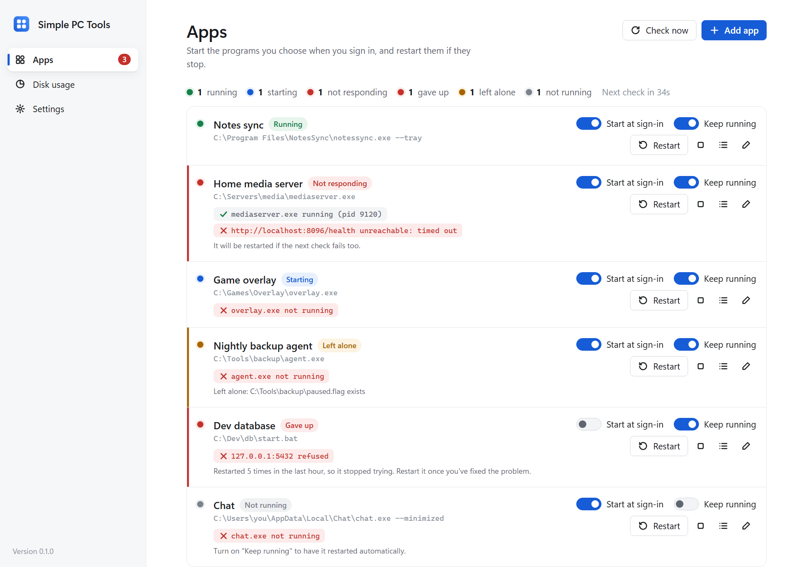
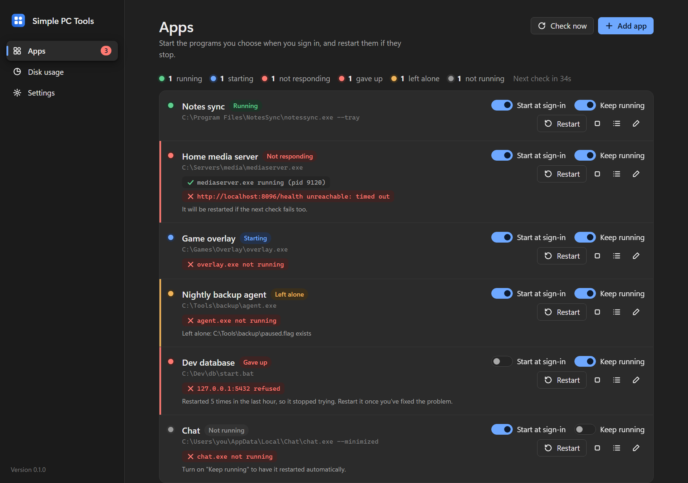
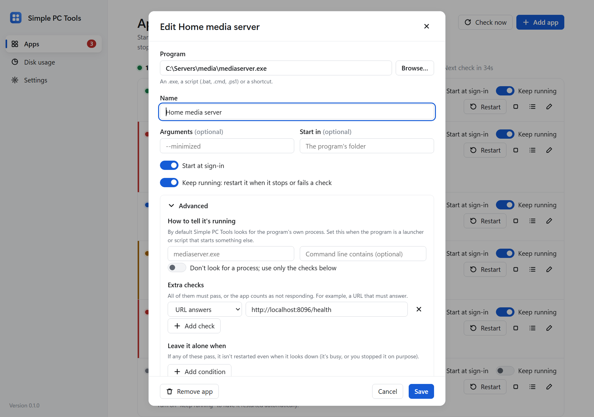
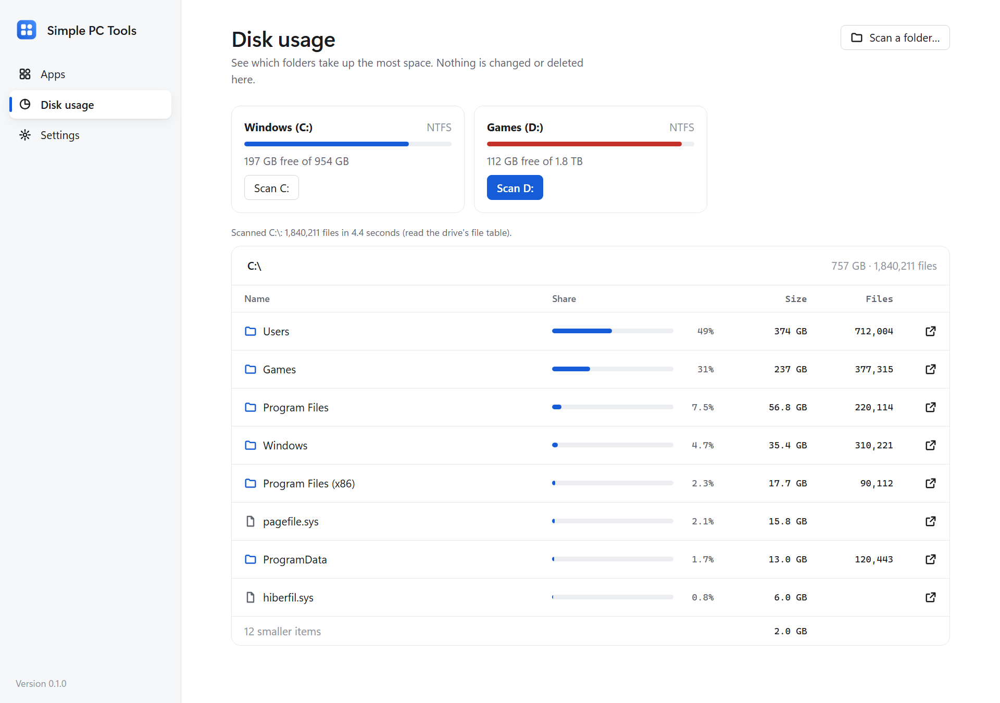
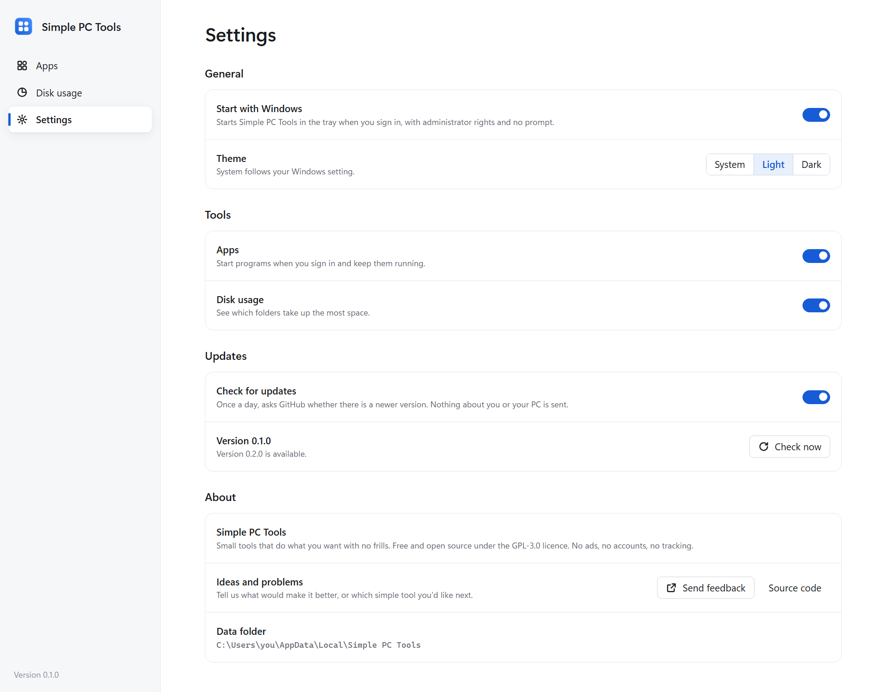
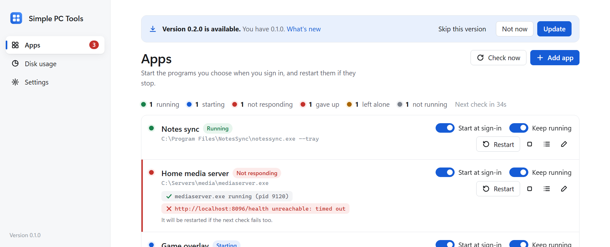

<p align="center"></p>

<h1 align="center">Simple PC Tools</h1>

<p align="center">Small tools for your Windows PC that do what you want, with no frills.<br>
Free and open source. No ads, no accounts, no tracking.</p>

<p align="center"><a href="../../releases/latest"><b>Download for Windows</b></a> ·
<a href="#install">Install guide</a> · <a href="BUILD.md">Build it yourself</a> ·
<a href="../../issues/new/choose">Suggest a tool</a></p>

<p align="center"></p>

---

There is a lot of annoying software out there: bloated, nagging, full of
upsells. Simple PC Tools is a growing set of small, plain tools that each do
one job well. Anyone can use them without reading a manual, and developers and
power users get an **Advanced** section when they want more control.

We build what people actually ask for. If there is a simple tool you wish you
had, or something here bugs you, [open an issue](../../issues/new/choose).

## The tools

### Apps: start programs when you sign in, and keep them running

Add a program, and Simple PC Tools starts it when you sign in. With **Keep
running** on, it restarts the program if it closes or crashes. Anything that
needs you is flagged in red or amber, with a count in the sidebar.

<p align="center"></p>

Under **Advanced**, power users can also:

- check that a URL answers, a port is open or a file exists, not just that the process runs;
- watch a different process when the program is a launcher or script;
- leave an app alone while a condition holds (for example, while you've paused it on purpose);
- set restart limits, a grace period after starting, and custom start and stop steps;
- run an app as administrator. By default apps start with your normal rights, just like opening them from the Start menu.

<p align="center"></p>

Programs it starts keep running if Simple PC Tools is closed or updated.

### Disk usage: see what fills your drive

Pick a drive or folder and see its folders sorted by size, biggest first. Click
into any folder, or open it in File Explorer. Because the app runs as
administrator, it reads the drive's file table directly (like WizTree): about
a million files in 10 seconds. It only looks, never changes or deletes
anything.

<p align="center"></p>

### Settings

Start with Windows, light, dark or system theme, which tools are on, and
update checks.

<p align="center"></p>

### More to come

Tell us what you'd like next.

## Install

1. Download `simple-pc-tools-setup-<version>.exe` from the
   [latest release](../../releases/latest).
2. Run it and follow the wizard (below).
3. Simple PC Tools appears in the tray by the clock and in the Start menu.

Prefer no installer? The release also has a **portable zip**: unzip it and run
`simple-pc-tools.exe`. Turn on **Settings → Start with Windows** if you want
it at sign-in.

> [!WARNING]
> **The installer isn't code-signed yet, so Windows will warn you.** Signing
> certificates cost money every year, and we haven't got one yet. You'll see:
>
> - **Your browser** may say the file "isn't commonly downloaded". Choose **Keep** (in Edge, under **…**).
> - **Windows SmartScreen** says "Windows protected your PC". Click **More info**, then **Run anyway**.
>
> If you'd rather not trust a download, every release is built from this
> source code by [GitHub Actions](.github/workflows/release.yml), and each
> release lists SHA-256 checksums. You can also [build it yourself](BUILD.md).

### The installer, step by step

It is a standard Windows setup wizard. Every choice has a sensible default, so
you can click **Next** all the way through.

| Page | What you choose | Default |
| --- | --- | --- |
| **Welcome** | Nothing: just what's about to happen | |
| **License** | Accept the GPL-3.0 licence | |
| **Install location** | Where the program goes | `C:\Program Files\Simple PC Tools` |
| **Select components** | Which tools to install. *Full installation* or *Custom* | All tools ticked |
| **Additional tasks** | **Start Simple PC Tools when I sign in**, and **Create a desktop shortcut** | Sign-in **on**, desktop shortcut off |
| **Ready to install** | A summary of your choices | |
| **Finish** | **Open Simple PC Tools now** | On |

The wizard asks for administrator rights once (a UAC prompt). With **Start
when I sign in** ticked, it creates a Task Scheduler task called **Simple PC
Tools**. That task starts the app at sign-in with administrator rights and
**no further prompts**. That is what lets the fast disk scan and app restarts
work quietly in the background.

**Updating** runs the same installer. It remembers your choices and skips
straight to installing. Updates started from inside the app run silently.

**Uninstalling** works like any app: **Windows Settings → Apps → Simple PC
Tools → Uninstall**. It removes the sign-in task and asks whether to also
delete your settings and app list (kept by default). Programs it started keep
running.

You can change any choice later without reinstalling: tools and Start with
Windows are switches in **Settings**.

For IT and scripted installs, the usual Inno Setup switches work:

```powershell
simple-pc-tools-setup-0.1.1.exe /VERYSILENT /COMPONENTS="core,apps,disk" /TASKS="autostart"
```

### Why administrator rights?

The fast disk scan needs them, and so does starting at sign-in without a UAC
prompt. Apps you add still start with your **normal** rights unless you choose
**Run as administrator** for that app. The app's controls are only reachable
from its own window, never over the network.

Settings and logs live in `%LOCALAPPDATA%\Simple PC Tools`.

## Updates

About once a day, the app asks GitHub whether there's a newer release. Only
that request is sent: nothing about you or your PC. When there is one:

<p align="center"></p>

- **Update**: downloads the installer, checks its SHA-256 checksum against the
  one GitHub publishes, and installs it. The app restarts on its own.
- **Not now**: asks again in a few days.
- **Skip this version**: never asks about that version again.

To stop the checks entirely, turn off **Settings → Check for updates**.

## Contributing

Ideas, bug reports and code are all welcome. [CONTRIBUTING.md](CONTRIBUTING.md)
explains how the code is laid out and how to add a new tool: a Rust module, a
page script, and a few one-line registrations that the tests check for you.
[DESIGN.md](DESIGN.md) has the UI rules that keep it looking consistent.

## Licence

[GPL-3.0-or-later](LICENSE). You can use, study, change and share it. If you
distribute a changed version, it must stay open source under the same licence.
